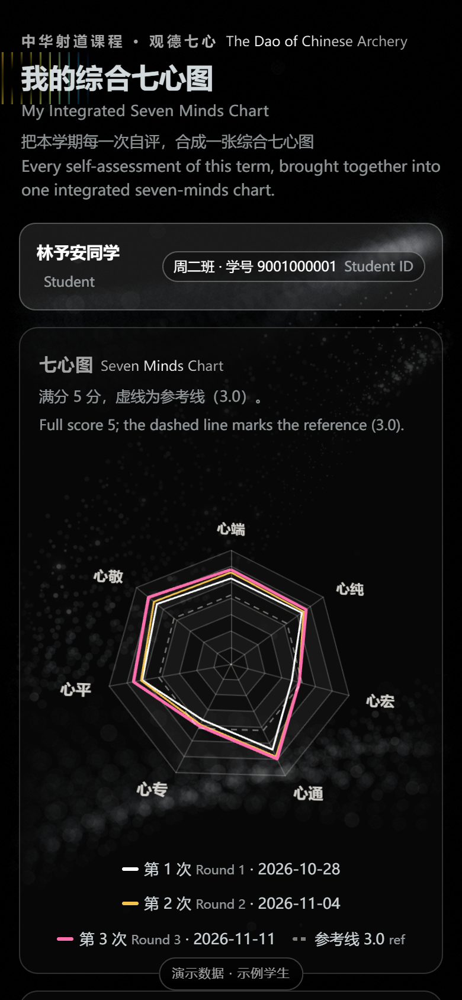
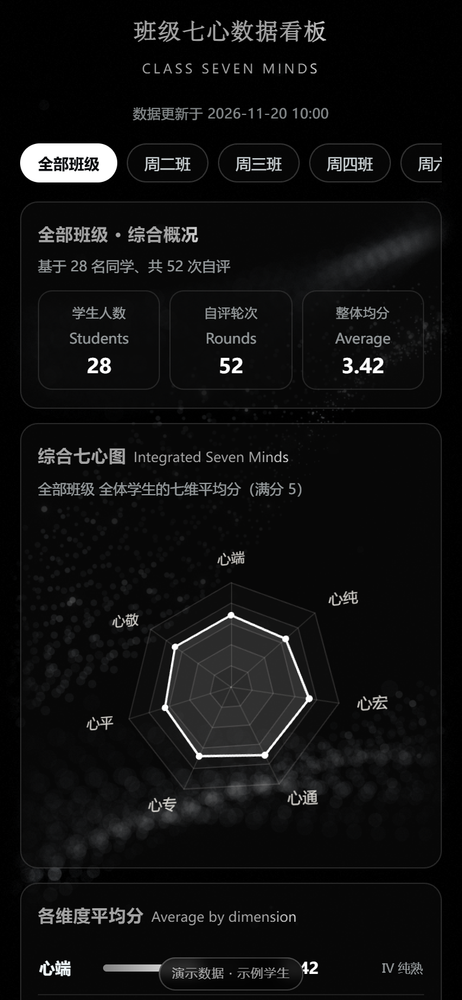

# 观德七心 · 射道课程自评数据查询系统

「中华射道」通识课程的七维自评结果查询工具。学生扫码、输学号姓名，两秒内看到自己的七轴雷达图；
教师端则是四个班的横向对比看板。

**在线演示**：<https://leep061642-cloud.github.io/guande-demo/>
（内置示例数据、无需登录、可直接点开；演示版是同一套前端代码的静态构建）



---

## 背景

课程每个学生每两节课做一次七心自评（21 道题、7 个维度）。原来结果散在问卷后台里的一堆表格中：
学生看不到自己历次答卷，教师也没法一眼看出班级的整体情况。这个项目把「答题 → 计算 → 出图」串成一条链路。

## 功能

**学生端**
- 封面 / 查询 / 结果三段式，手机优先，全部在微信 WebView 内完成
- 七轴雷达：支持「本次」与「历次平均」双序列对比，3.0 参考虚线作为中等水平锚点，数据线逐条生长动画
- 每个维度配横条与一句自然语言解读（外侧稳定 / 内侧还有空间），不依赖图例

**教师端**
- 学号与姓名核对、PBKDF2 口令登录
- 四个班级 + 全部班级的七维均值、学生数、轮次数
- 班级切换、总览卡片



## 技术栈

| 层 | 选型 |
|---|---|
| 前端 | 原生 HTML / CSS / JavaScript（零构建、零框架依赖） |
| 图表 | ECharts 5（定制七轴雷达、生长动画） |
| 背景 | WebGL2 / GLSL（自研纤维丝带，实例化绘制 + 5 级 Bloom） |
| 服务端 | Python 3 标准库 `http.server`（ThreadingHTTPServer） |
| 数据 | 问卷平台 Open API（签名查询 + 分页抓取 + 并发详情） |
| 鉴权 | Web Crypto PBKDF2（教师口令，盐与迭代次数随页面下发） |

## 目录结构

```
.
├── index.html              # 封面：纤维背景 + 查询入口
├── brief/index.html        # 学生查询 / 结果页（含内嵌教师面板）
├── teacher/index.html      # 独立教师入口
├── demo/index.html         # 静态演示版（数据内置、单文件可托管）
├── fibers/                 # WebGL 纤维背景（原生版本 + 降级静帧）
├── gx-fluid.js             # 弹簧动画引擎（面板手势 / 按压反馈）
└── _server/
    ├── live_server.py      # 路由、静态服务、页面数据注入
    ├── gx_live.py          # 答卷抓取、缓存、聚合
    ├── tools/              # 答卷解析与指标计算
    └── config/             # 班级与量表映射
```

## 本地运行

```bash
# 1) 准备凭证：把示例文件改名并填入问卷平台的 access_token
cp _server/config/creds.example.json _server/creds.json

# 2) 启动
python3 _server/live_server.py 3000

# 3) 打开
open http://localhost:3000
```

没有凭证也能看：`demo/index.html` 是纯静态页，双击即可打开，数据全部内置。

## 三个实现要点

**1. 分页参数的陷阱**
问卷平台的答卷列表接口里，`page_count` 只是响应回显字段，真正的分页参数是 `page_size`，且服务端硬上限 100 条。
早期代码按 `page_count=500` 请求，每页只回 10 条 —— 结果是「后台已收 71 份，系统只认 10 份，后交卷的学生查不到」。
改为按 `total_answer` 自适应翻页（每页 100、空页即停、安全上限 1 万份），四个班并行拉取，
单份详情 12 路并发并带失败重试，19 份的全量同步从 4.1s 降到 1.3s。

**2. 学号的脏数据归一**
真实答卷里同时存在 9 位纯数字与「字母 + 数字」共 10 位的学号，姓名与学号的上下顺序也不固定。
解析时按「是否含 4 位以上连续数字」判断字段角色，取最长字母数字串并统一大写；
匹配走「精确命中 → 唯一后缀 → 数字段」三级策略，把历史短学号与新学号归并到同一个人。

**3. 演示版做成单文件**
作品集需要一个「评委随时能点开」的演示页。做法是把数据烘焙进页面、拦截 `fetch` 的接口调用、
把 WebGL 组件与降级海报以 base64 内联，最终得到一个 1.3 MB 的自包含 HTML，可直接托管在静态空间上。

## 数据与隐私

- 仓库内**不含任何真实学生数据**：姓名、学号、答卷都来自运行时的问卷平台接口，不落仓库。
- `demo/` 里的人物与学号全部是虚构示例。
- 访问凭证（`_server/creds.json`）不入库，见 `.gitignore`。

## 说明

个人作品，保留所有权利。可自由查看、参考。
